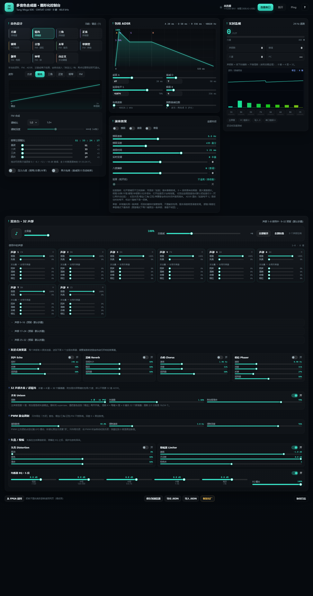

# 网页图形化控制台

FPGA 钢琴合成器的参数全部搬到了**运行时寄存器**，通过板载 USB 串口（UART）实时读写，
这个目录就是配套的中文网页控制台：**纯前端、单页、无外部依赖、离线可用**。

> ★ 2026-10-26 第三轮新增：**八度控制**、**延音踏板**、**32 声部混音台**（前 8 路使用中，9–32 默认折叠）、
> 每通道 **音量 / 失真 / 回声 / 混响 / 合唱 / 相位 发送量**、4 个**全局发送式效果器**、
> 主**失真**、主**限幅器**、5 段**均衡器**，以及 **32 声部齐奏/超锯齿（8 键 × 4 层）**。
> 所有功能都有可调滑块。




---

## 一、快速开始

### 1. 线怎么插

| 项目 | 说明 |
|------|------|
| 串口在哪 | 板上丝印 **`DEBUG-USB2`** 的 USB-C 口（就是下载码流用的那个口） |
| 不要用 | `USB3.0` 那个 Type-C（那是 CH569 的 USB3，和本功能无关） |
| 芯片 | 板载 **BL616** 调试器，同时提供 **USB-JTAG + UART** |
| 电脑上看到 | 设备管理器 → 端口 → **两个** `USB Serial Port (COMx)`：<br>**A 通道 = JTAG**（下载码流用）、**B 通道 = UART**（我们要的） |
| 用哪个 | **B 通道**（本机实测 A=COM5 / B=COM6；`tools\串口监视.cmd` 会自动认出 B 通道） |
| 接线 | 一根 USB-C **数据线**，不需要外接 CH340 |
| 电平/波特率 | 3.3V LVCMOS，**115200 8N1** |

> ⚠️ 如果你一定要用外接 CH340 模块：**不能**并在 U15/V14 上（会和 BL616 的输出打架）。
> 只能把 `src/fpga_project.cst` 里的 `UART_TX` / `UART_RX` 改到 40P 排针上的两个空闲 3.3V IO，
> 然后重新综合布线。端口名不用改，网页也不用改。

### 2. 打开网页

**推荐**：双击 `启动控制台.cmd`（需要 Python；会自动起本地服务器并打开浏览器）。

也可以直接双击 `index.html`（Chrome / Edge 通常也允许 Web Serial；如果提示不支持，
就用上面的 .cmd，或者手动 `python -m http.server 8765` 后访问
`http://127.0.0.1:8765/index.html`）。

> Web Serial 需要 **Chrome / Edge 89+**，Firefox / Safari 不支持。
> 第一次连接会弹一个系统串口选择框，选 `USB Serial Port (COMx)`。

### 3. 连接

1. 板子上电（PWR 长按 2 秒），插好 `DEBUG-USB2`。
2. 点右上角 **「连接串口」** → 选 COM 口。
3. 状态灯变绿、右下角开始刷新「遥测帧」就说明通了。
4. 点 **Ping** 可以在日志里看到 `PONG：固件 v1.1`。

> **连接时网页会把当前状态推给 FPGA**（音色 + 全部参数 + 32 声道 + 效果器 + EQ）。
> 也就是说：网页是"编辑端"，听到的永远和页面显示一致。
> 想反过来看 FPGA 里现在是什么值，点底部的 **「从 FPGA 读回」**。
> 读回只会改页面显示，不会动你保存的本地预设；点一下预设就能恢复。

---

## 二、界面说明

| 区域 | 能做什么 |
|------|---------|
| **音色设计** | 11 个预设按钮（方波/锯齿/三角/正弦/钢琴/古筝/木琴/单簧管/颠琴/钟琴/自定义）、波形选择、波形预览、FM 调制比/深度、钢琴泛音配比、压力力度/单次包络开关 |
| **包络 ADSR** | ADSR 四个滑块（拖滑块 = 步长对数刻度，右边数字框可以直接填原始步长）、包络速率、指数衰减位数；上方有实时包络曲线和每段耗时 |
| **演奏效果** | 颤音 / 滑音 / 单音三个开关；颤音速率、颤音深度、滑音时间、实时变调（±12 半音）、**八度偏移（±2）** |
| **混音台 · 32 声部** | 主音量/静音/总衰减；1–8 声部展开、9–32 默认折叠；每通道 6 条滑块：音量、失真、回声/混响/合唱/相位 4 路发送量 |
| **发送式效果器** | 回声、混响、合唱、相位 4 个全局效果器，各带开关 + 3~4 条参数滑块 |
| **失真 / 限幅** | 主失真（驱动/音色/混合）、限幅器（阈值/天花板/软拐点） |
| **均衡器 EQ** | 5 段（低频/中低/中频/中高/高频）−24~+12 dB 滑块 + EQ 输出 |
| **实时监视** | 压力力度 0~127、ADC 原始值、**声部数/峰值（含齐奏层）**、八度、I²C 状态、8 个按键灯、错误计数、遥测帧号 |
| **底部** | 从 FPGA 读回 / 保存到浏览器 / 导出 JSON / 导入 JSON / 恢复出厂；协议日志（可勾选显示收发帧） |

> **布局**：宽屏上方三列——左列「音色设计」，中列「包络 + 演奏效果」，右列「实时监视」；
> 下方是**全宽 32 声部混音台 + 效果器 + EQ**。1400px 以下混音台主控换行，980px / 640px 继续收窄。

### 演奏效果怎么用

| 效果 | 行为 | 参数 |
|---|---|---|
| **颤音** | 全局 LFO 调制音高（所有声部同步） | 速率 0.5~12.0 Hz；深度约 ±0~±104 音分 |
| **滑音** | 新音高不立刻跳过去，而是按时间常数指数逼近 | 时间常数 τ ≈ 20µs~672ms（`2^shift/48.8k`） |
| **单音** | 8 个键共用一条声部，最后按下的键接管音高；只要还有键按着就**不重触发包络** | 无（配合滑音就是实时滑音变调） |
| **实时变调** | 整体移调 ±12 半音；拖动时按住音会跟着变 | ±12 半音 |
| **八度偏移** | 整体升降 ±2 个八度；和板上 KBD_UP / KBD_DN 是同一个状态 | −2 ~ +2 |
| **延音（松开后）** | 像钢琴延音踏板：松手后不立刻消失，而是慢慢衰减 | 0 = 关；1~127 越大尾音越长（默认 40） |

> 滑音在**复音模式**下几乎听不出来：每个键固定一条声部，同一个键反复按音高不变、不同键用不同声部。
> 想听滑音/实时变调，请打开**单音**，然后按住一个键再按另一个键。

**八度怎么用**

- 「演奏效果」卡片里的 **八度偏移** 滑块范围 **−2 ~ +2**，每格 12 个半音。
- 和板上的 `KBD_UP` / `KBD_DN` 是**同一个状态**：网页拖滑块会立刻改 FPGA；按板上八度键，
  遥测回报后网页滑块也会跟着动（约 42ms 内）。
- 音域限幅在 MIDI 24~108（C1~C8 附近），到边界就不再升/降。

**延音（松开后）怎么用**

- 这是**钢琴延音踏板**那类效果：松手后不马上静音，而是按滑块慢慢衰减。
- **只对 one-shot 音色（钢琴 / 古筝 / 木琴 / 颠琴 / 钟琴）有效**。
  - **钢琴 / 古筝 / 木琴**：切过去默认把延音归 0；
  - **颠琴 / 钟琴**：切过去默认开延音（当前为 0 时给 40，已有值保留）。
  - 切到方波/锯齿/三角/正弦/单簧管时自动关到 0 并禁用滑块（硬件里 `pedal_en` 也按 `oneshot` 门控）。
  - 手动改过延音后保持，直到下一次切音色。
- `0` = 关闭（恢复音色原来的释音）；数值越大，尾音越长。手动从 0 拉起后，默认 40 大约 **1 秒**拖尾。
- 打开延音后，one-shot 的**按住衰减也放慢 4 倍**，所以不会按一会儿就衰减到 0；松手时还有包络可拖。
- 它和 ADSR 里的 **S（延音电平）** 不是一回事：S 是"按住时停在多大音量"，
  「延音（松开后）」是"松手后掉到 0 要多久"。
- 如果音色在按住期间已经衰减到静音（例如按住钢琴超过 ~2.4 秒），再松手不会有尾音——
  这是包络本身的特性，踏板只能延长"还有包络值"的那一段。

---

## 三、★ 32 声部混音台 / 效果器 / 均衡器（2026-10-26 第三轮）

### 架构：为什么是"发送式"

```
声部 1..32（当前键盘只用 1–8）
   │  每通道：音量 → 失真 → 4 路发送量
   ├──────────────► 干声 ─────────────────────────────┐
   ├─ 回声发送 ───► fx_echo（延时线 335ms）───────────┤
   ├─ 混响发送 ───► fx_reverb（4 梳状 + 2 全通）──────┤
   ├─ 合唱发送 ───► fx_mod 合唱（调制延时）───────────┤
   └─ 相位发送 ───► fx_mod 相位（短延时 + 反馈）──────┤
                                                       ▼
                                     失真 → 5 段 EQ → 限幅 → 主音量 → DAC
```

每通道只控制"送多少"到 4 个**全局**效果器，而不是给 32 个通道各做一套延时线：
后者需要 32 份 BSRAM 和几十个乘法器，这颗 60K 放不下。专业调音台也是这个结构。

### 每通道滑块

| 滑块 | 范围 | 说明 |
|---|---|---|
| 音量 | 0~128 | 128 = 原音量；乘在该声部 PCM 上 |
| 失真 | 0~127 | 预增益 1/2/4/8 倍 + 软削波 + 干湿混合；0 = 完全干净 |
| 回声 / 混响 / 合唱 / 相位 | 0~15 | 4 路辅助发送量；0 = 不送，15 = 最大 |

> 声部 1–8 对应 8 个琴键；9–32 是**预留声部**，默认折叠。点「全部展开」可以给未来
> 32 声部分配提前设好音量/发送量，当前没有音源驱动它们，所以不会发声。
>
> ★ **自动打开效果器**：某通道的 4 路发送量从 0 拉高时，网页会自动把对应的全局效果器
> 开关打开并下发，不需要再手动点一次「开」。手动关掉后，再动该路发送量会再次自动打开。

> 发送总线在 FPGA 里是 `>>2` + 入口 `soft16` 软限幅；8 个声部同时满发送也不会硬削波。

### 全局效果器

| 效果器 | 参数 | 听感 / 实现 |
|---|---|---|
| **回声 Echo** | 延时 10~324ms、反馈 0~94%、返回量 | 一条 16384 点 BSRAM 延时线，反馈 <1 不会自激 |
| **混响 Reverb** | 空间大小、阻尼、返回量 | 4 个并联梳状（22.9/24.3/26.2/27.8ms）+ 2 个全通，阻尼低通 |
| **合唱 Chorus** | 速率 0.09~6Hz、深度、返回量 | 约 14ms 调制延时，LFO 三角波，轻微音高漂移 |
| **相位 Phaser** | 速率 0.05~3Hz、深度、反馈、返回量 | 约 4ms 短延时 + 反馈 + LFO 扫延时（镶边式相位扫频） |

> 相位器严格意义上是级联全通滤波器，需要多个乘法器；这里用"短延时 + 反馈 + LFO"
> 实现同类"喷气/漩涡"听感，资源只需 2 块 BSRAM。

### 失真 / 限幅

| 功能 | 参数 | 说明 |
|---|---|---|
| **失真 Distortion** | 驱动、音色、混合 | 主链前级；驱动越大削波越硬，音色控制后级低通 |
| **限幅 Limiter** | 阈值（约 −18~0dBFS）、天花板、软拐点 | EQ 之后；超过阈值后按 1/2~1/16 斜率压缩，再钳到天花板 |

### 均衡器 EQ（5 段）

| 段 | 分频点 | 滑块 |
|---|---|---|
| 低频 | < 120 Hz | −24 ~ +12 dB |
| 中低 | 120–500 Hz | −24 ~ +12 dB |
| 中频 | 0.5–1 kHz | −24 ~ +12 dB |
| 中高 | 1–5 kHz | −24 ~ +12 dB |
| 高频 | > 5 kHz | −24 ~ +12 dB |
| EQ 输出 | 0~255 | 总输出微调 |

> 5 段和原信号严格相加等于原信号（0dB 时完全透明）。分频点是固定的，
> 每段增益可调；寄存器里存的是 1/16 线性增益（16 = 0dB）。

### 32 声部齐奏 / 超锯齿（8 键 × 4 层）

主声部仍然是每个键原来的振荡器（第 1 层）；齐奏再给每个键加 **3 个微失谐锯齿层**，
所以 **8 键 × 4 层 = 32 个振荡器**。附加层共用主声部的包络和力度，不需要 24 套 ADSR。

| 参数 | 范围 | 说明 |
|---|---|---|
| 开关 | 0/1 | 关 = 只用主声部（8 个振荡器） |
| 层数 | 1~4 | 总层数（含主声部）；4 层 = 32 个振荡器，3 层 = 24，2 层 = 16 |
| 失谐量 | 0~127 | 约 0.1%~12.5%（`δ = inc >> (10 - detune[6:4])`） |
| 附加层混合 | 0~127 | 附加 3 层与主声部的混合量 |

- **默认是开、4 层、失谐 64（≈1.56%）、混合 100（≈79%）**，上电就能听到 32 声部的厚度。
- **监视器「声部数」**：FPGA 遥测的 `POLY` 只数按下的琴键/主声部；网页按齐奏层数换算成
  实际声部数（8 键 × 4 层 = 32，单键 4 层 = 4），峰值也按换算后的值统计。
- 想要纯 supersaw：音色选「锯齿」，再把齐奏打开、失谐调到 30~70。
- 钢琴/FM 音色开齐奏会叠加锯齿层，听感会变亮/变厚；不喜欢就关掉。
- 附加层是**锯齿**，不跟随主音色的波形（主声部是什么音色，第 1 层就是什么）。
- 附加层会跟随主声部的滑音/颤音（用的是当前的相位增量 `inc_vib`）。

### PWM 脉宽调制（只作用在方波）

| 参数 | 范围 | 说明 |
|---|---|---|
| 基础脉宽 | 0~255 | 128 = 50% 占空比；越小声音越薄 |
| 调制速率 | 0~127 | 0.1Hz 单位，30 = 3Hz |
| 调制深度 | 0~127 | 0 = 固定脉宽；越大占空比摆动越大 |

- 寄存器：`0x2D PWM_WIDTH`、`0x2E PWM_RATE`、`0x2F PWM_DEPTH`。
- 只对**方波**音色有效；锯齿/三角/正弦/钢琴/FM 不受影响。
- 实现用移位 LFO，不占 DSP；默认 128 / 30 / 96。

### 新增两个 FM 音色

| 编号 | 名称 | ratio | depth | 包络 |
|---|---|---|---|---|
| 8 | 颠琴 | 2.0 | >>>2 | one-shot，短促电钢 |
| 9 | 钟琴 | 3.5 | >>>1 | one-shot，明亮钟声 |

- 两个都是 one-shot（`oneshot=1`），所以「延音（松开后）」对它们也有效。
- 网页预设按钮变成 **11 个**；其中 **自定义** 是网页端伪音色，不写 FPGA 的 `TIMBRE`。
- `0x10 TIMBRE` 仍接受 0~9；自定义只覆盖音色参数。

### 自定义音色

- 选中任意预设后，手动改 **波形 / FM 比例/深度 / ADSR / 泛音配比 / 单次包络**，
  网页会自动切到「自定义」档，并保存当前参数。
- 自定义档不发送 `TIMBRE=10`（FPGA 只认 0~9），只发送全部音色参数；
  所以 FPGA 的实际音色号保持上一个预设，但声音是自定义参数。
- 再点任意预设即可退出自定义；按板上 KEY0 也会退出并跟随硬件音色。
- 手动改 PWM 时如果当前不是方波，会自动切到方波并进入自定义档（PWM 只作用方波）。

### 监视器波形/频谱

- 网页「实时监视」下方新增 **波形 / 频谱预览**：按当前音色、PWM、按键数在浏览器里估算，
  用于快速看参数变化；**HDMI 上是真实音频的 4 段频谱**（8 条显示）。
- HDMI 频谱来自 `spectrum4.v` 的真实 `mix_pcm`，不是电脑端数据；网页预览不是音频回传。

**操作习惯**

- 所有改动都是**实时下发**的：拖动滑块约 40Hz 合并发送，不会刷爆串口。
- 每个音色的参数在网页里是**分开记**的：切到别的音色再切回来，刚才的修改还在；
  改动会立刻同步进「当前音色的本地预设」，所以切走不会丢。
- 按板上的 **KEY0 短按**换音色，网页会跟着切，并**把网页里这一档的参数推回 FPGA**
  —— 这样你在网页上改过的音色不会被 FPGA 的出厂预设覆盖。
- **KEY0 长按**仍然切压力调试界面（HDMI 输出），这个功能没变。
- 改完想留着就点「保存到浏览器」；想搬到别的电脑就「导出 JSON」。
  ⚠️ 参数在 FPGA 里是**掉电丢失**的：重新烧录/断电后回到出厂预设，
  网页连上时会自动把本地保存的状态再推下去。

---

## 四、参数对照表

| 类别 | 参数 | 现在的位置 | 网页里的控件 | 寄存器 |
|---|---|---|---|---|
| 音色 | 当前音色号 | `timbre_sel`（已可变） | 11 个预设按钮（含自定义） | `0x10` |
| 音色 | 方波/锯齿/三角/正弦/钢琴/FM 选择 | `wave_sel` | 波形分段按钮 | `0x11` |
| 音色 | FM 调制比 | 原来写死在 `mod_inc` | FM 调制比下拉框 | `0x12` |
| 音色 | FM 调制深度 | 原来写死在 `m_dep` | FM 调制深度滑块 | `0x13` |
| 音色 | 钢琴泛音配比 | 原来写死在 `wave8` | 4 条泛音衰减滑块 | `0x14`~`0x17` |
| 包络 | 起音/衰减/延音/释音 | `ADSR_*` | ADSR 四个滑块 + 数字框 | `0x22`~`0x25` |
| 包络 | 包络速率、指数衰减 | `adsr_rate / adsr_exp` | 包络速率 / 指数衰减滑块 | `0x20` / `0x21` |
| 演奏 | 颤音 / 滑音 / 单音 | 全局 LFO / 相位增量逼近 | 演奏效果卡片 | `0x1A`~`0x1F` |
| 演奏 | 实时变调 | 音符号加偏移 | 实时变调滑块 | `0x26` |
| **演奏** | **八度偏移（±2）** | 板上 KBD_UP/DN + 网页 | **八度滑块** | **`0x27`** |
| **演奏** | **延音（松开后）** | `adsr.v` 释音段 + 全局踏板 | **延音滑块** | **`0x28`** |
| 混音 | 总衰减 `MIX_SHIFT` | 运行时寄存器 | 总衰减滑块 | `0x30` |
| 混音 | 主音量 / 静音 | 运行时寄存器 | 主音量滑块 + 静音按钮 | `0x31` / `0x32` |
| **混音** | **32 声道音量/失真** | `fx_channel_mix` | 每声道 2 条滑块 | **`0x80`~`0x9F`** |
| **混音** | **32 声道 4 路发送** | `fx_channel_mix` | 每声道 4 条滑块 | **`0xA0`~`0xBF`** |
| **效果** | **回声 / 混响 / 合唱 / 相位** | `fx_echo / fx_reverb / fx_mod` | 4 个效果器卡片 | **`0x50`~`0x60`** |
| **效果** | **主失真 / 限幅** | `fx_master` | 失真 / 限幅卡片 | **`0x61`~`0x68`** |
| **均衡** | **5 段 EQ + 输出** | `fx_master` | 均衡器卡片 | **`0x69`~`0x6F`** |
| **齐奏** | **32 声部超锯齿** | `unison_saw`（附加 3 层/键） | 齐奏卡片 | **`0x29`~`0x2C`** |

---

## 五、寄存器表

地址是 8 位，值统一 16 位、**小端**（低字节先）。

| 地址 | 名称 | 范围 | 默认 | 说明 |
|---|---|---|---|---|
| `0x01` | VERSION | — | 0x0101 | 只读，固件版本 |
| `0x10` | TIMBRE | 0~9 | 1 | 当前音色号；**写它会自动装载该音色的出厂预设** |
| `0x11` | WAVE | 0~5 | 1 | 0方波 1锯齿 2三角 3正弦 4钢琴(加法) 5FM |
| `0x12` | FM_RATIO | 0~7 | 1 | 0.5 / 1.0 / 1.5 / 2.0 / 2.5 / 3.0 / 3.5 / 4.0 |
| `0x13` | FM_DEPTH | 0~4 | 2 | 调制深度 = 调制器输出 >>> n |
| `0x14`~`0x17` | HARM1~4_ATT | 0~3 | 0 | 各次泛音衰减（0=×1, 1=×1/2, 2=×1/4, 3=×1/8） |
| `0x18` | VEL_PRESS | 0/1 | 0/1 | 1 = 用压力力度（钢琴/古筝/木琴预设为 1） |
| `0x19` | ENV_ONESHOT | 0/1 | 0/1 | 1 = 衰减到 0 自动结束（打击音） |
| `0x1A` | MONO | 0/1 | 0 | 1 = 单音模式 |
| `0x1B` | GLIDE_EN | 0/1 | 0 | 1 = 滑音 |
| `0x1C` | GLIDE_SHIFT | 0~15 | 10 | 滑音时间常数 τ = 2^n / 48.8kHz |
| `0x1D` | VIB_EN | 0/1 | 0 | 1 = 颤音 |
| `0x1E` | VIB_RATE | 0~255 | 55 | 0.1Hz 单位（55 = 5.5Hz） |
| `0x1F` | VIB_DEPTH | 0~127 | 40 | 峰值约 ±0~±104 音分 |
| `0x20` | ENV_RATE | 0~4 | 0 | 包络每 2^n 个采样点更新一次（>4 与 4 相同） |
| `0x21` | ENV_EXP | 0~15 | 0 | 0=线性；>0=每拍减当前值的 1/2^n |
| `0x22` | ATK_STEP | 1~65535 | 67 | 起音步长（0 会被钳成 1） |
| `0x23` | DEC_STEP | 0~65535 | 7 | 衰减步长（线性模式用） |
| `0x24` | SUS_LEVEL | 0~65535 | 45874 | 延音电平 |
| `0x25` | REL_STEP | 0~65535 | 4 | 释音步长 |
| `0x26` | TRANSPOSE | -12~+12 | 0 | 实时变调；**有符号 16 位补码** |
| `0x27` | OCTAVE | -2~+2 | 0 | **八度偏移**；有符号补码，写同一个值也会触发一次 |
| `0x28` | SUSTAIN | 0~127 | 40 | **延音（松开后）**；0=关，越大释音越慢；只对 one-shot 音色生效，切到持续音网页自动置 0 |
| `0x29` | UNISON_ON | 0/1 | 1 | **32 声部齐奏**开关 |
| `0x2A` | UNISON_LAYERS | 1~4 | 4 | 总层数（含主声部）；4 = 8 键 × 4 层 = 32 个振荡器 |
| `0x2B` | UNISON_DETUNE | 0~127 | 48 | 失谐量；约 0.1%~12.5% |
| `0x2C` | UNISON_MIX | 0~127 | 48 | 附加 3 层与主声部的混合量 |
| `0x2D` | PWM_WIDTH | 0~255 | 128 | 方波基础占空比；128=50% |
| `0x2E` | PWM_RATE | 0~127 | 30 | PWM LFO 速率（0.1Hz） |
| `0x2F` | PWM_DEPTH | 0~127 | 96 | PWM 调制深度；0=固定脉宽 |
| `0x30` | MIX_SHIFT | 0~6 | 2 | 总衰减：右移 n 位（÷2^n） |
| `0x31` | MASTER_VOL | 0~255 | 255 | 主音量，内部约 5ms 平滑 |
| `0x32` | MUTE | 0/1 | 0 | 静音 |
| `0x38`~`0x3F` | KEY_VOL0~7 | 0~128 | 128 | 每个键/声部的音量（保留，网页已用通道音量替代） |
| `0x40` | ADS_VEL | 只读 | — | 实时力度 0~127 |
| `0x41` | ADS_RAW | 只读 | — | AIN0 原始高字节 0~255 |
| `0x42` | POLY | 只读 | — | 当前按键/主声部数；**网页会按齐奏层数换算成声部数**（8 键 × 4 层 = 32） |
| `0x43` | POLY_PEAK | 只读 | — | 峰值按键/主声部数（网页换算后显示声部峰值） |
| `0x44` | OCT_SHIFT | 只读 | — | 八度偏移（有符号，-2~+2） |
| `0x45` | KEY_MASK | 只读 | — | 8 个键的按下状态（bit0=KBD[0]） |
| `0x46` | FLAGS | 只读 | — | bit0 ads_ok, bit1 page_dbg, bit2 ads_seen[0] |
| `0x47` | ADS_ERR | 只读 | — | ADS1115 通信错误计数 |
| `0x50` | ECHO_ON | 0/1 | 0 | 回声开关 |
| `0x51` | ECHO_TIME | 0~255 | 110 | 延时 = 512 + n×60 采样（10.5~324ms） |
| `0x52` | ECHO_FB | 0~15 | 6 | 反馈 = n/16（0~94%） |
| `0x53` | ECHO_MIX | 0~127 | 64 | 湿声返回量 |
| `0x54` | REV_ON | 0/1 | 0 | 混响开关 |
| `0x55` | REV_SIZE | 0~127 | 64 | 空间大小（梳状反馈） |
| `0x56` | REV_DAMP | 0~127 | 64 | 阻尼（越大越暗） |
| `0x57` | REV_MIX | 0~127 | 64 | 湿声返回量 |
| `0x58` | CHO_ON | 0/1 | 0 | 合唱开关 |
| `0x59` | CHO_RATE | 0~127 | 40 | 0.09~6Hz（`inc=32+n×16`） |
| `0x5A` | CHO_DEPTH | 0~127 | 40 | 调制深度 |
| `0x5B` | CHO_MIX | 0~127 | 64 | 湿声返回量 |
| `0x5C` | PHA_ON | 0/1 | 0 | 相位开关 |
| `0x5D` | PHA_RATE | 0~127 | 40 | 0.05~3Hz（`inc=16+n×8`） |
| `0x5E` | PHA_DEPTH | 0~127 | 40 | 调制深度 |
| `0x5F` | PHA_FB | 0~15 | 4 | 反馈 = n/16 |
| `0x60` | PHA_MIX | 0~127 | 64 | 湿声返回量 |
| `0x61` | DRV_ON | 0/1 | 0 | 主失真开关 |
| `0x62` | DRV_DRIVE | 0~127 | 0 | 驱动（预增益 + 混合） |
| `0x63` | DRV_TONE | 0~127 | 64 | 音色低通（越小越暗） |
| `0x64` | DRV_MIX | 0~127 | 64 | 干湿混合 |
| `0x65` | LIM_ON | 0/1 | 1 | 限幅器开关 |
| `0x66` | LIM_TH | 0~255 | 224 | 阈值（约 −18~0dBFS） |
| `0x67` | LIM_CEIL | 0~255 | 255 | 天花板（约 −12~0dBFS） |
| `0x68` | LIM_REL | 0~127 | 64 | 软拐点 1~4（越大越软） |
| `0x69` | EQ_ON | 0/1 | 1 | 均衡器开关 |
| `0x6A` | EQ_LOW | 1~63 | 16 | 低频增益（16 = 0dB，1/16 线性） |
| `0x6B` | EQ_LMID | 1~63 | 16 | 中低 120–500Hz |
| `0x6C` | EQ_MID | 1~63 | 16 | 中频 0.5–1kHz |
| `0x6D` | EQ_HMID | 1~63 | 16 | 中高 1–5kHz |
| `0x6E` | EQ_HIGH | 1~63 | 16 | 高频 >5kHz |
| `0x6F` | EQ_OUT | 0~255 | 255 | EQ 输出微调 |
| `0x80`~`0x9F` | CH_A[0..31] | 16 位 | `0x0080` | `{失真[15:8], 音量[7:0]}`，音量 0~128 |
| `0xA0`~`0xBF` | CH_B[0..31] | 16 位 | 0 | `{相位[15:12], 合唱[11:8], 混响[7:4], 回声[3:0]}`，每路 0~15 |

只读寄存器返回的是**最近一次遥测快照**（约 24Hz 更新），用于调试。

---

## 六、串口协议

```
A5 5A | TYPE | LEN | PAYLOAD[LEN] | CRC8
```

- **CRC8**：多项式 `0x07`、初值 `0x00`，覆盖 `TYPE`、`LEN`、`PAYLOAD`
  （标准向量：`"123456789"` → `0xF4`）。
- PC → FPGA：

| TYPE | 含义 | PAYLOAD |
|---|---|---|
| `0x01` | SET 写参数 | N × `{addr, val_lo, val_hi}`，N ≤ 16（LEN ≤ 48） |
| `0x02` | GET 读参数 | N × `{addr}`，N ≤ 16 |
| `0x03` | PING | 空 |

- FPGA → PC：

| TYPE | 含义 | PAYLOAD |
|---|---|---|
| `0x81` | VALUE（GET 回包） | N × `{addr, val_lo, val_hi}` |
| `0x82` | TELEM 遥测 | 固定 16 字节（见下） |
| `0x83` | PONG | `{主版本, 次版本}` = `{1, 1}` |

**遥测 16 字节**

| 字节 | 内容 | 字节 | 内容 |
|---|---|---|---|
| 0 | TIMBRE | 8 | FLAGS |
| 1 | WAVE | 9 | ADS_ERR |
| 2 | ADS_VEL | 10 | MASTER_VOL |
| 3 | ADS_RAW | 11 | `{4'b0, MIX_SHIFT, MUTE}` |
| 4 | POLY | 12 | 参数写入计数 |
| 5 | PEAK | 13 | 串口错误计数 |
| 6 | OCT（有符号） | 14~15 | 遥测帧计数（小端） |
| 7 | KEY_MASK | | |

**例子**（可以直接用串口助手发）：

```
切到钢琴：  A5 5A 01 03 10 04 00 AE
PING：      A5 5A 03 00 3F
读音色号：  A5 5A 02 01 10 B3
八度 +1：   A5 5A 01 03 27 01 00 18
延音 40：   A5 5A 01 03 28 28 00 4C
齐奏 4 层： A5 5A 01 03 2A 04 00 C8
```

**命令行工具**（不打开网页也能调，适合先验证硬件）：

> 最省事：**双击 `tools\串口监视.cmd`**，它会列出现有 COM 口、让你输入串口名，
> 然后监听 30 秒遥测。不需要懂 PowerShell。

```powershell
# 在工程根目录打开 PowerShell 后：
.\tools\synthctl.ps1 -Cmd list
.\tools\synthctl.ps1 -Port COM7 -Cmd ping
.\tools\synthctl.ps1 -Port COM7 -Cmd monitor -Seconds 10
.\tools\synthctl.ps1 -Port COM7 -Cmd set -Reg 0x10 -Val 4
```

如果提示“禁止运行脚本”，用这一行（不修改系统策略）：
```powershell
powershell -NoProfile -ExecutionPolicy Bypass -File .\tools\synthctl.ps1 -Port COM7 -Cmd monitor -Seconds 10
```

---

## 七、已知限制 / 需要知道的几件事

1. **`ENV_RATE` 实际只到 4**
   `adsr.v` 里 `rate_cnt` 是 4 位，`(1<<rate)-1` 在 `rate≥4` 时会被截成 15，
   所以 rate 4~15 的效果完全一样（都是每 16 个采样点更新一次）。网页只开放 0~4。

2. **指数衰减的实际尾音比旧 README 里写的短**
   旧 README 的「钢琴尾音 5.4s」是按**线性** `dec_step=1` 算的；现在钢琴用的是
   `exp=9 / rate=3`，实际是按 1/512 指数衰减，到 −60dB 大约 **0.6 秒**。
   网页上显示的 D 时间是按真实算法算的；想更长就把 `ENV_EXP` 调大（每 +1 翻倍）
   或把 `ENV_RATE` 调大。

3. **钢琴泛音是「衰减」而不是任意改写配比**
   4 个泛音的权重仍然由常数 `51:33:24:17` 决定，网页上的 4 条滑块是
   **分别把对应泛音再右移 0~3 位**（×1/×1/2/×1/4/×1/8）。全 0 时和原来完全一致。

4. **`osc_voice.v` 里钢琴那段的定标本来就不太对**
   综合日志会报 `Expression size 32 truncated to fit in target size 17`（`wave8`）。
   这一轮**没有动它**（保持现有音色不变），只在外面加了泛音衰减。
   如果觉得钢琴音色「怪 / 薄」，可以下一步单独重写这段加法合成。

5. **只综合了 8 个声部，32 声部是"名义 + 折叠预留"**
   `NUM_VOICES=32`，但键盘模式只用 0~7 声部，综合器把 8~31 全部 sweep 掉了
   （日志里的 `NL0002 ... g_voice[8..31]`）。网页仍显示 32 个通道条，
   9~32 默认折叠、参数可以提前设好；当前没有音源驱动它们，所以不会发声。
   要做真·32 声部复音，需要动态声部分配 + 更多 DSP，属于下一步。

6. **每通道的"效果"是发送量，不是独立效果器**
   4 路发送（0~15）送到 4 个全局效果器。这是为了在 60K 上放得下：
   32 套独立延时线需要 32 份 BSRAM，DSP 和布线都过不了。

7. **发送量只有 0~15（4 位）**
   16 级对辅助发送够用；如果以后要更细，可以把 A/B 两个寄存器重新分包，
   但 32 通道 × 6 参数已经用掉 64 个地址，8 位地址空间不多了。

8. **相位器是"镶边式"实现**
   用短延时 + 反馈 + LFO 扫延时，听感属于相位/喷气类，但不是教科书上的
   级联全通相位器（那需要每声部多个乘法器）。

9. **波特率固定 115200**
   改的话要同时改 `top.v` 里 `u_uart_rx/u_uart_tx` 的 `BAUD`，并重新综合。

10. **`rxbuf` 被综合器当成 RAM**
    日志里有 `Extracting RAM for identifier 'rxbuf'`，实际是寄存器/LUT 实现，
    异步读没问题（这个 warning 可以忽略）。

11. **演奏效果的几个细节**
    - **颤音**乘的是“当前相位增量”，深度是**音分**（和音高无关）。
    - **滑音**是指数逼近，时间常数 τ = 2^shift/48.8kHz；复音模式下几乎听不出来，请配合**单音**。
    - **单音**是最后按键优先：后按的键接管音高，只要还有键按着，包络不重触发。
    - **实时变调 / 八度**都受音域 24~108 限幅。

---

## 八、常见问题

| 现象 | 排查 |
|---|---|
| 网页提示「当前浏览器不支持 Web Serial」 | 换 Chrome/Edge；用 `启动控制台.cmd` 以 `http://localhost` 打开 |
| 点连接后看不到 COM 口 | 设备管理器里有没有 `USB Serial Port (COMx)`？没有就换数据线 / 装驱动 / 换 USB 口 |
| 连上了但遥测一直是 0 / 不刷新 | 看日志有没有 CRC 错误；确认 FPGA 烧的是**今天这版**码流；按一下 Ping |
| Ping 没反应 | 串口选错、FPGA 没跑起来（看 LED）、或者 `BAUD` 不匹配 |
| 改了参数没声音变化 | 先确认在**正常界面**（不是压力调试页）；看「实时监视」的复音数有没有动；`MUTE`/主音量是否为 0 |
| 某个键没有效果 | 检查该声部的 4 路发送量是否为 0；效果器开关是否打开；返回量是否太低 |
| 效果器有杂音/爆音 | 先把通道音量/主音量调低，或把 `MIX_SHIFT` 调大（总衰减）；限幅阈值不要高于天花板 |
| 按键换音色后参数被覆盖 | 正常：网页会把这一档的本地参数推回 FPGA。想听 FPGA 出厂预设就点「恢复出厂」 |
| 网页刷新后参数回到默认 | 参数在 FPGA 里是易失的；网页的预设要点「保存到浏览器」 |
| 声音有咔哒 | 主音量/静音已经做了 5ms 平滑；如果是切音色瞬间的，属于包络重置，正常 |

---

## 九、文件

```
web/
  index.html        页面结构
  style.css         样式（深色主题，无外部依赖）
  app.js            协议 + Web Serial + 全部交互（Node 也能 require 做协议自测）
  serve.py          本地静态服务器（自动开浏览器）
  启动控制台.cmd     双击即用
  README.md         本文件
tools/
  protocol_test.js  Node 协议自测：node tools/protocol_test.js（28 项）
  synthctl.ps1      PowerShell 串口命令行工具
  monitor.ps1       串口监视小工具（中文界面 + 列出口 + 提示输入）
  串口监视.cmd      ★ 双击即可：列出口 -> 输入 COM7 -> 监听 30 秒遥测
```

> 效果链的 FPGA 实现见 `src/fx_channel_mix.v`、`fx_echo.v`、`fx_reverb.v`、
> `fx_mod.v`、`fx_master.v`、`fx_chain.v`；寄存器定义见 `src/param_regs.v` 文件头。
